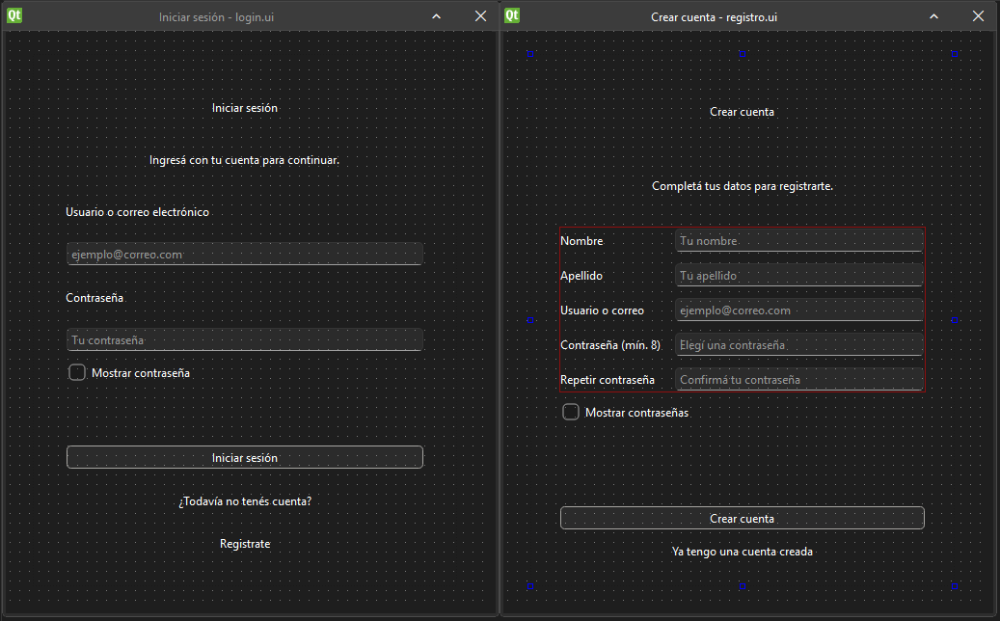
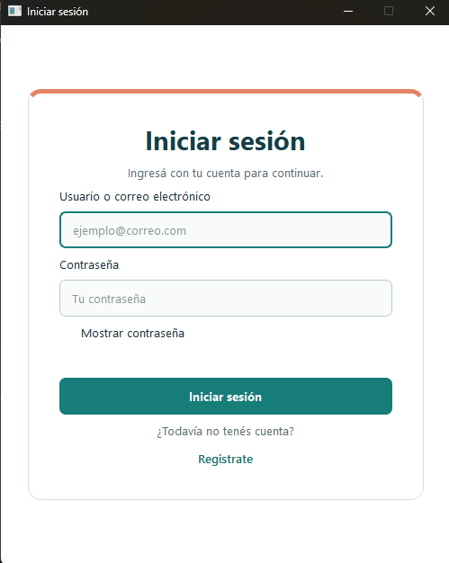
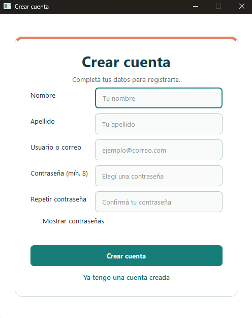
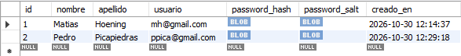
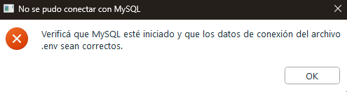
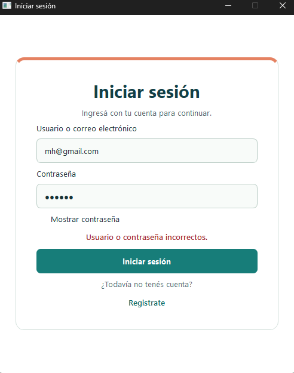
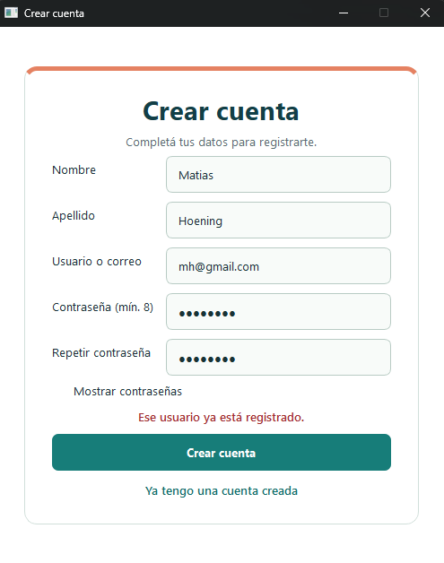
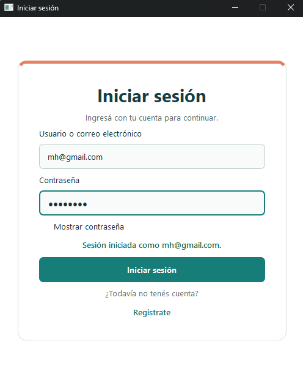
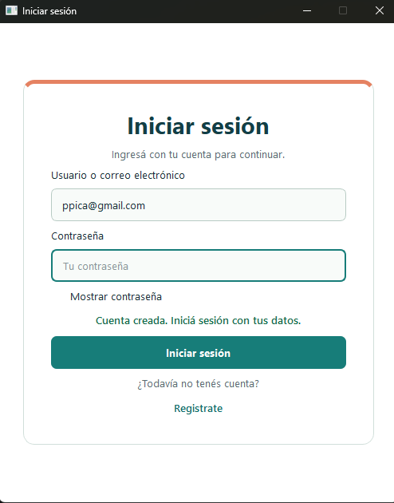

# Login y registro con PyQt6

Aplicación de escritorio de inicio de sesión y registro. Las pantallas se diseñan en Qt Designer, se cargan desde archivos `.ui` y comparten un servicio de autenticación conectado a MySQL.

## Requisitos

- Python 3.10 o posterior.
- MySQL Server en ejecución. MySQL Workbench puede usarse para administrar la base de datos, pero no reemplaza al servidor.
- PyQt6 y las dependencias de `requirements.txt`.

## Instalación y configuración

```powershell
py -m venv .venv
.\.venv\Scripts\Activate.ps1
python -m pip install -r requirements.txt
Copy-Item .env.example .env
```

En el Workbench, abri y ejecuta [`base-de-datos/conexion.sql`](base-de-datos/conexion.sql) para crear la base de datos. Eso luego crea la tabla `usuarios` al iniciar si todavía no existe.

Si se cambia `MYSQL_DATABASE`, cambiá también el nombre de la base al comienzo de `conexion.sql`.

```powershell
python main.py
```

La aplicación no usa usuarios en memoria ni continúa en modo simulado si falla la conexión: muestra un error de configuración/conexión para que pueda corregirse.

## Funcionalidades

- Registro con nombre, apellido, usuario, contraseña y confirmación.
- Validaciones de campos obligatorios, contraseña de al menos 8 caracteres y coincidencia de confirmación.
- Inicio de sesión con usuario normalizado (sin distinguir mayúsculas/minúsculas).
- La contraseña no se guarda tal como se escribió. El programa calcula un hash y guarda esa huella junto con un dato aleatorio propio de cada cuenta. Al iniciar sesión, vuelve a calcular la huella y la compara con la guardada. Así puede comprobar la contraseña sin almacenarla.
- Persistencia de usuarios en MySQL y restricción de duplicacion para el usuario.
- Tras crear una cuenta, navegación automática al login, con el usuario completado y un mensaje de confirmación. El botón para volver manualmente desde registro sigue disponible.
- Mensajes visibles de validación, error y éxito.

## Desafíos realizados

- **Integración:** navegación entre pantallas en una sola ventana, validación de formularios, servicio de autenticación separado de la interfaz y persistencia SQL.
- **Protección de contraseñas:** cada contraseña se transforma muchas veces con un procedimiento llamado PBKDF2 y se combina con un dato aleatorio distinto para cada cuenta. Esto hace más difícil deducir la contraseña original si alguien accediera a los datos guardados.

## Decisiones de diseño

- Cada pantalla tiene una clase controladora y un archivo `.ui` y las ventanas no contienen consultas SQL.
- `ServicioAutenticacion` concentra las reglas de autenticación y `RepositorioUsuariosMySQL` se encarga del acceso a datos.
- El proyecto conserva el método de protección de contraseñas que ya tenía. En MySQL se guarda la huella calculada y el dato aleatorio de cada cuenta; nunca se guarda la contraseña original.
- MySQL se configura mediante variables de entorno en `.env`; no hay credenciales predeterminadas en el código.
- La tabla tiene una restricción `UNIQUE` para que dos registros simultáneos tampoco puedan duplicar el usuario.
- La aplicación informa los errores de conexión o persistencia; no sustituye MySQL por una lista en memoria.

## Limitaciones conocidas

- Se requiere un servidor MySQL iniciado y una base creada antes de ejecutar la aplicación.
- Es un ejemplo educativo de autenticación de escritorio: no implementa recuperación de contraseña, gestión de sesiones, bloqueo por intentos ni migraciones/versionado de esquema.
- El usuario identifica la cuenta; no se valida que tenga formato de correo electrónico.
- La credencial de conexión debe protegerse en el entorno donde se distribuye la aplicación. Para un sistema multiusuario real, las credenciales de base de datos no deberían distribuirse dentro de cada cliente de escritorio.

## Capturas



- Ventanas iniciales en Designer



- Login Final mejorado en `estilos.qss`



- Registro Final mejorado en `estilos.qss`




- Guardado en base de datos SQL.

### Errores



- Al no poner las credenciales correctas o no poder conectar a SQL.



- Al no poner la contraseña correcta en el inicio de sesion.



- Al querer crear un usuario que ya está creado en el registro de usuario.

### Aciertos



- Al poner la contraseña correcta en el inicio de sesion.



- Al poner los campos de registro correctos en el registro de usuario.
